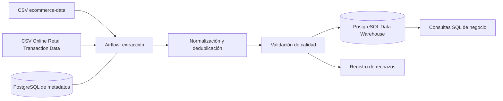

# DataMart S.A.S. — Pipeline ETL con Apache Airflow y PostgreSQL

Proyecto para la prueba de desempeño **Pipeline ETL con Apache Airflow y Data Warehouse**. La solución procesa dos fuentes CSV, estandariza sus esquemas, separa ventas y devoluciones, registra rechazos, deduplica registros y carga un repositorio analítico PostgreSQL mediante un DAG diario de Airflow en Docker.

> **Estado honesto:** las pruebas unitarias y validaciones estáticas incluidas pasan en el entorno de preparación. No se ha podido validar el arranque real de Docker desde aquí y los CSV completos no están incluidos. La ejecución integral se debe confirmar en un equipo con Docker y los datasets reales.

## 1. Arquitectura



Hay dos bases PostgreSQL separadas: `airflow-db` guarda los metadatos de Airflow; `warehouse-db` guarda las tablas analíticas. El servicio `airflow-init` configura usuario administrador, conexión y variables antes de iniciar webserver y scheduler.

## 2. Estructura del repositorio

- `docker-compose.yml`: servicios de Airflow y PostgreSQL.
- `Dockerfile`, `requirements.txt`: imagen de Airflow con dependencias del ETL.
- `dags/datamart_etl_dag.py`: DAG diario y dependencias entre tareas.
- `dags/etl_pipeline.py`: lógica de transformación, validación, deduplicación y categorías.
- `sql/001_schema.sql`: creación de tablas, índices y vista.
- `sql/queries.sql`: consultas para las preguntas de negocio.
- `scripts/init_env.py`: genera `.env` local con secretos aleatorios.
- `scripts/profile_sources.py`: explora los CSV y genera un perfil de columnas, nulos y duplicados.
- `docs/decisiones_tecnicas.md`: decisiones y limitaciones.
- `docs/data_model.dbml`: diagrama compatible con dbdiagram.io.
- `tests/`: pruebas unitarias de las reglas principales.
- `data/seeds/`: archivos sintéticos pequeños para pruebas de humo; no representan los resultados reales.

## 3. Requisitos

- Docker Desktop o Docker Engine con Docker Compose v2.
- Python 3.11 recomendado para scripts y pruebas locales.
- Aproximadamente 4 GB de memoria disponible para Docker.
- Puertos locales `8080` y `5433` libres.

## 4. Preparar las fuentes de datos

La prueba exige dos fuentes:

1. Fuente de transacciones: [Kaggle — E-Commerce Data](https://www.kaggle.com/datasets/carrie1/ecommerce-data). Coloca `data.csv` en `data/raw/data.csv`.
2. Fuente histórica elegida: [Kaggle — Online Retail Transaction Data](https://www.kaggle.com/datasets/thedevastator/online-retail-transaction-data). Descarga el archivo de datos de esa página y colócalo como `data/raw/online_retail_II.csv`. Este es el nombre local esperado por el proyecto; no presupone el nombre original que Kaggle dé al archivo.

Los archivos completos no se incluyen en este ZIP. Deben descargarse desde las fuentes y usarse de acuerdo con sus condiciones de licencia. No uses los CSV sintéticos de `data/seeds/` para calcular resultados finales de negocio.

### Perfilado inicial (antes del ETL)

Desde la carpeta raíz, ejecuta:

```bash
python -m pip install pandas pytest
python scripts/profile_sources.py
```

El script informa si faltan archivos y, cuando están presentes, registra filas, encabezados, nulos y duplicados exactos en `reports/source_profile.json`. Abre el perfil y confirma que la segunda fuente tenga campos equivalentes a factura, código de producto, descripción, cantidad, fecha, precio, cliente y país. El transformador mapea alias habituales; si el CSV real usa nombres diferentes, ajusta `aliases` en `dags/etl_pipeline.py` y añade una prueba antes de ejecutar el pipeline.

## 5. Inicio desde cero

Abre una terminal en la carpeta raíz del repositorio.

### Paso 1 — Generar secretos locales

```bash
python scripts/init_env.py
```

Esto crea `.env` sin sobrescribir un archivo existente. No subas `.env` a Git. El usuario de Airflow es `admin`; su contraseña queda en `AIRFLOW_ADMIN_PASSWORD` dentro de `.env`.

### Paso 2 — Construir y levantar los servicios

```bash
docker compose up --build -d
```

### Paso 3 — Revisar estado y logs

```bash
docker compose ps
docker compose logs --tail=100 airflow-init airflow-webserver airflow-scheduler warehouse-db
```

Espera a que `airflow-init` termine correctamente y a que el webserver y el scheduler sigan activos. Si un servicio falla, revisa primero sus logs antes de continuar.

### Paso 4 — Abrir Airflow

Visita [http://localhost:8080](http://localhost:8080), inicia sesión con `admin` y la contraseña de `.env`.

### Paso 5 — Comprobar configuración automática

En Airflow UI, revisa **Admin → Connections** y confirma que existe `warehouse_postgres`, con host `warehouse-db`, puerto `5432` y base definida en `.env`. En **Admin → Variables**, comprueba `source_one_path`, `source_two_path`, `reject_invalid_rows` y `batch_size`. El servicio `airflow-init` las registra al iniciar; no deberían requerir configuración manual.

### Paso 6 — Ejecutar el DAG

En **DAGs**, busca `datamart_daily_etl` y pulsa **Trigger DAG**. Confirma que las tareas `extract_source_one`, `extract_source_two`, `transform_and_deduplicate`, `validate_data_quality` y `load_analytical_warehouse` finalicen correctamente.

El DAG tiene programación diaria (`@daily`), reintentos automáticos y `max_active_runs=1`.

## 6. Validar la carga en PostgreSQL

```bash
docker compose exec warehouse-db psql -U warehouse -d datamart_dw -c "SELECT COUNT(*) FROM analytics.fact_transactions;"
docker compose exec warehouse-db psql -U warehouse -d datamart_dw -c "SELECT transaction_type, COUNT(*) FROM analytics.fact_transactions GROUP BY 1;"
docker compose exec warehouse-db psql -U warehouse -d datamart_dw -c "SELECT reason, COUNT(*) FROM analytics.rejected_records GROUP BY 1;"
```

Para ejecutar las consultas de negocio:

```bash
docker compose exec -T warehouse-db psql -U warehouse -d datamart_dw < sql/queries.sql
```

También puedes conectarte desde un cliente SQL local a `localhost:5433`, usando base `datamart_dw` y el usuario y contraseña de `.env`.

## 7. Pruebas locales

Las pruebas unitarias no requieren Docker:

```bash
python -m pip install pandas pytest
python -m pytest -q
python -m compileall -q dags scripts tests
```

Las pruebas verifican que las devoluciones se separen, el ingreso neto se calcule, los códigos se normalicen, los clientes sin ID se conserven como nulos, los precios no positivos se rechacen y los duplicados equivalentes entre fuentes se eliminen.

## 8. Decisiones importantes

- Las líneas con cantidad menor o igual a cero se etiquetan como devoluciones/ajustes; el importe devuelto se calcula en valor absoluto y resta del ingreso neto.
- Las líneas con precio no positivo, cantidad inválida, fecha inválida o factura/código ausente se envían al log de rechazos con motivo y payload.
- Los customer ID ausentes se conservan como `NULL`, sin inventar clientes.
- La descripción canónica se selecciona por frecuencia después de normalizar a mayúsculas; los empates se resuelven alfabéticamente.
- Los códigos de producto se normalizan a mayúsculas y sin espacios.
- La clave de deduplicación es un hash estable de factura, código, cantidad, precio, fecha UTC, cliente y país. Es una decisión explícita; requiere revisión si las fuentes pueden reutilizar identificadores de factura.
- Las fechas se convierten a UTC. Los formatos de entrada se interpretan según la fuente y deben confirmarse con el perfil real.
- La categoría se estima con reglas heurísticas porque la API de catálogo es opcional. Debe reemplazarse por un catálogo confiable cuando esté disponible.
- Los datasets son de comercio minorista del Reino Unido. No se inventa una conversión a COP/MXN/PEN; se requieren moneda y tasas de cambio si se comparan importes de distintas monedas.

El detalle está en `docs/decisiones_tecnicas.md`; el modelo está en `docs/data_model.dbml`; las siete preguntas de negocio y subconsultas están en `sql/queries.sql`.

## 9. Apagar el entorno

```bash
# Detiene servicios y conserva datos en volúmenes.
docker compose down

# ADVERTENCIA: elimina también los datos persistidos del warehouse y Airflow.
docker compose down -v
```
