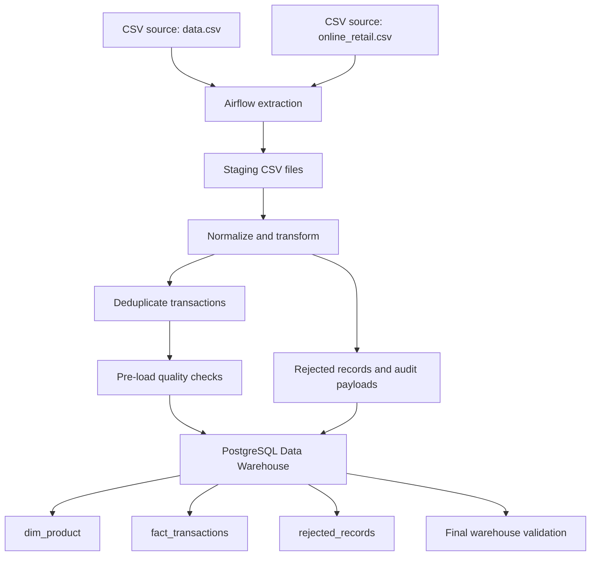
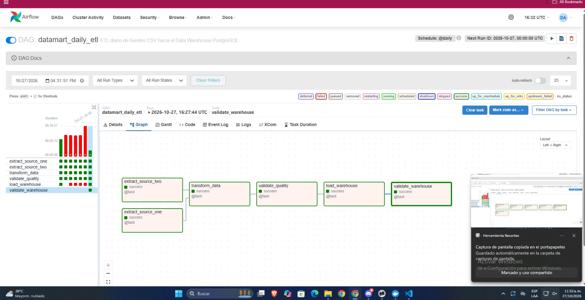
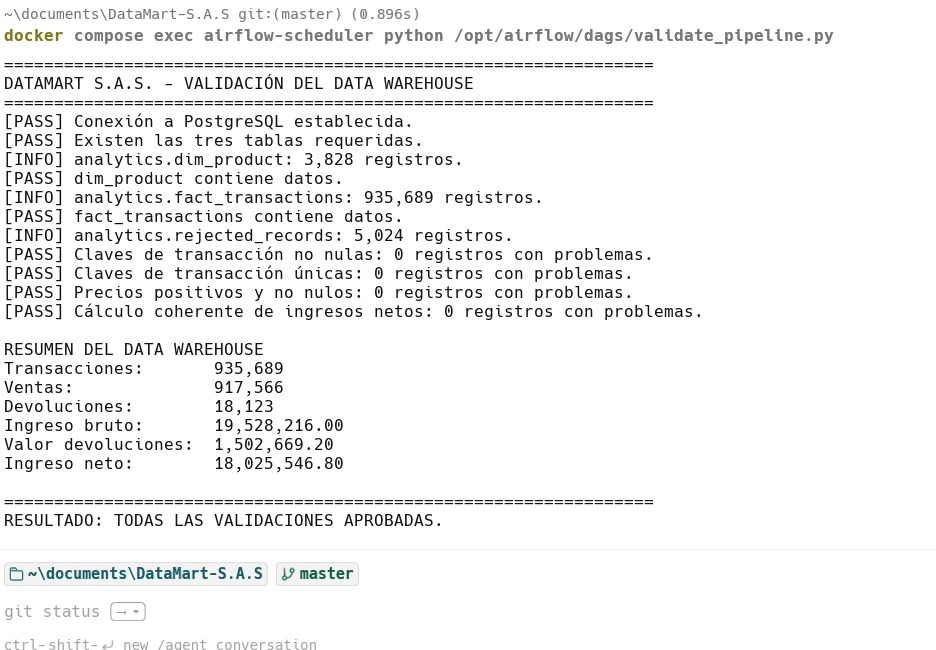

# 🛒 DataMart S.A.S. — Retail ETL & Analytical Data Warehouse

<p align="center">
  <strong>From raw retail CSV files to a validated PostgreSQL analytical warehouse</strong><br>
  <em>Orchestrated with Apache Airflow · Built with Python and pandas · Containerized with Docker</em>
</p>

<p align="center">
  
  
  
  
  
</p>

## 📌 Project overview

DataMart S.A.S. is a retail data engineering project that processes two CSV sources and loads validated, deduplicated records into a PostgreSQL analytical warehouse. Apache Airflow orchestrates the workflow, while Python and pandas handle extraction, normalization, transformation, and quality checks.

The pipeline separates valid transactions from rejected records, preserves rejection details for auditing, and validates the warehouse after loading.

## 🧰 Technology stack

| Technology | Role in the project |
|---|---|
| 🐍 Python 3.11 | ETL logic, validation and orchestration code |
| 🌬️ Apache Airflow 2.10.5 | DAG scheduling, dependencies, retries and task logs |
| 🐼 pandas | CSV ingestion, data cleaning and transformation |
| 🐘 PostgreSQL 16 | Analytical warehouse and audit tables |
| 🔌 psycopg2 | PostgreSQL connections and batch inserts |
| 🐳 Docker Compose | Reproducible local services |
| 📄 CSV and JSON | Input files and intermediate staging data |
| 🧪 pytest / Ruff | Testing and code quality, when configured in the repository |

## 🏗️ Architecture



## 🔄 ETL workflow

The Airflow DAG is named `datamart_daily_etl`.

1. **`extract_source_one`** — locates and extracts the primary CSV source.
2. **`extract_source_two`** — locates and extracts the second CSV source.
3. **`transform_data`** — normalizes fields, validates records, deduplicates equivalent transactions, and writes intermediate JSON files.
4. **`validate_quality`** — checks transaction keys, prices, transaction types, and revenue calculations before loading.
5. **`load_warehouse`** — loads the product dimension, transaction facts, and rejected records into PostgreSQL.
6. **`validate_warehouse`** — checks the stored tables, duplicate keys, invalid prices, revenue consistency, and final row counts.

The two extraction tasks run in parallel. Transformation follows both extractions, and the final warehouse validation must run after `load_warehouse`.

## 🗄️ Analytical data model

The pipeline expects these tables in the PostgreSQL `analytics` schema:

| Table | Purpose |
|---|---|
| `analytics.dim_product` | Product dimension: product code, canonical description, and category |
| `analytics.fact_transactions` | Valid sales and returns, transaction identifiers, quantities, prices, timestamps, and revenue measures |
| `analytics.rejected_records` | Rejected input records, rejection reason, source name, and JSON payload for audit |

Products without a category in the source data receive the placeholder category `UNCLASSIFIED`. This value indicates that the product has not been classified; it does not represent a guessed product category.

## 🛡️ Data quality and idempotency

The pipeline includes checks for:

- Missing invoice or product identifiers.
- Invalid invoice dates and numeric values.
- Missing or non-positive unit prices.
- Fractional quantities in a dataset expected to use whole-unit quantities.
- Duplicate transaction keys across sources.
- Allowed transaction types: `SALE` and `RETURN`.
- Revenue consistency: `net_revenue = gross_revenue - return_amount`.
- Null or duplicate transaction keys in the warehouse.

The fact load uses `ON CONFLICT (transaction_key) DO NOTHING`. Product rows use `ON CONFLICT (product_code) DO UPDATE`, and rejected rows use `ON CONFLICT (rejection_key) DO NOTHING`. These safeguards rely on the matching unique constraints being present in the database schema.

## 📸 Execution evidence

### 1. Airflow DAG

The screenshot below was provided during project execution and shows the DAG graph with the extraction, transformation, quality validation, warehouse load, and final validation tasks displayed as successful in that captured run.



### 2. PostgreSQL warehouse validation

The validator output below was provided from the project terminal. It reports that the required tables exist and that the implemented checks for null transaction keys, duplicate keys, invalid prices, and revenue consistency passed.



### 📊 Reported warehouse results

The supplied validation output reported the following figures:

| Metric | Reported value |
|---|---:|
| Products in `dim_product` | 3,828 |
| Transactions in `fact_transactions` | 935,689 |
| Rejected records | 5,024 |
| Sales | 917,566 |
| Returns | 18,123 |
| Gross revenue | 19,528,216.00 |
| Return amount | 1,502,669.20 |
| Net revenue | 18,025,546.80 |

These figures reflect the run shown in the supplied evidence. Re-run the validator after subsequent code or data changes before treating them as the current totals.

## 🚀 Getting started

### Prerequisites

- Docker Desktop with Docker Compose.
- Git, if cloning the repository.
- Source CSV files included in or provided to the project.
- A configured Airflow connection named `warehouse_postgres`.
- PostgreSQL DDL that creates the required tables and unique constraints.

### 1. Clone the repository

Replace the placeholder with the Git URL provided by the evaluator:

```bash
git clone <REPOSITORY_URL>
cd DataMart-S.A.S
```

### 2. Configure environment variables

Copy the example environment file:

**PowerShell**
```powershell
Copy-Item .env.example .env
```

**macOS / Linux**
```bash
cp .env.example .env
```

Set local values in `.env`. Do not commit `.env` or real credentials. Keep `.env.example` populated with variable names and safe example values only.

### 3. Start the services

Run from the project root, where `docker-compose.yml` is located:

```bash
docker compose up --build -d
```

Check service status:

```bash
docker compose ps
```

### 4. Configure the Airflow connection

In the Airflow web interface, open **Admin → Connections** and configure a connection with the ID:

```text
warehouse_postgres
```

Set the host, port, database, username, and password to match the PostgreSQL warehouse service and its configuration. From another container, the host is typically the Compose service name rather than `localhost`.

### 5. Configure Airflow Variables

Open **Admin → Variables** and verify the variables used by the DAG:

| Variable | Default / purpose |
|---|---|
| `source_one_path` | Defaults to `/opt/airflow/data/raw/data.csv` |
| `source_two_path` | Defaults to `/opt/airflow/data/raw/online_retail.csv` |
| `batch_size` | Defaults to `5000` rows per insert batch |

Make sure the configured paths exist inside the Airflow container, not just on the host machine.

### 6. Check the DAG and Python syntax

```powershell
docker compose exec airflow-scheduler python -m py_compile /opt/airflow/dags/datamart_etl_dag.py
docker compose exec airflow-scheduler airflow dags list
```

### 7. Run the pipeline

In Airflow, find `datamart_daily_etl` and trigger a manual run. Wait for all six tasks to finish successfully, especially `load_warehouse` and `validate_warehouse`.

### 8. Validate the loaded data

Run the standalone validator:

```powershell
docker compose exec airflow-scheduler python /opt/airflow/dags/validate_pipeline.py
```

Expected final message:

```text
RESULTADO: TODAS LAS VALIDACIONES APROBADAS.
```

The standalone validator should be run again after the latest ETL execution so that the results reflect the current warehouse state.

## 🧪 Testing

If the repository includes pytest tests, run them from the environment where the project's dependencies are installed:

```bash
pytest -q
```

If Ruff is configured in the project, run:

```bash
ruff check .
ruff format --check .
```

Only report tests as passing when these commands have actually completed successfully.

## 🧯 Troubleshooting

| Symptom | What to check |
|---|---|
| DAG does not appear | Check the scheduler logs and run `airflow dags list` |
| CSV file not found | Confirm the file is mounted into the container and the Airflow Variable path is correct |
| PostgreSQL connection fails | Check the `warehouse_postgres` connection and Docker Compose service name |
| `category` violates `NOT NULL` | Confirm missing categories are mapped to `UNCLASSIFIED` |
| `record_payload` is missing | Confirm `transform_data` generates all required rejection columns |
| Duplicate conflict or failed upsert | Verify the unique constraints match the `ON CONFLICT` columns |
| Task fails in Airflow | Inspect the failed task's full log before retrying |

Do not delete warehouse tables as a first troubleshooting step. Inspect the exception and correct the schema, mapping, or configuration.

## 📂 Repository layout

The following is the intended layout. Keep it aligned with the files actually present in the repository.

```text
DataMart-S.A.S/
├── dags/
│   ├── datamart_etl_dag.py
│   ├── etl_pipeline.py
│   └── validate_pipeline.py
├── data/
│   ├── raw/
│   └── staging/
├── docs/
│   └── evidence/
├── reports/
├── scripts/
├── sql/
├── src/
├── tests/
├── .env.example
├── .gitignore
├── docker-compose.yml
├── Dockerfile
├── requirements.txt
└── README.md
```

## 📦 Delivery checklist

- [ ] `docker-compose.yml` defines the required services.
- [ ] `.env.example` documents required configuration without real secrets.
- [ ] DAG code and Python dependencies are included.
- [ ] DDL scripts create the warehouse tables and required constraints.
- [ ] Required sample CSVs or seed data are included or documented.
- [ ] README setup steps work from a clean clone.
- [ ] Airflow Connection and Variables are documented.
- [ ] Technical decisions and ambiguous-case handling are documented.
- [ ] Data model diagram is included or linked.
- [ ] SQL validation queries cover every question in the assignment's Section 7.
- [ ] DAG and standalone warehouse validation pass on the latest run.
- [ ] Evidence images are included in `docs/evidence/`.
- [ ] `.env`, generated caches, and unnecessary runtime logs are excluded from Git.

---

<p align="center">
  <strong>🛒 DataMart S.A.S. | Retail Data Engineering</strong><br>
  <em>Reliable ingestion · Transparent data quality · Auditable analytics</em>
</p>
